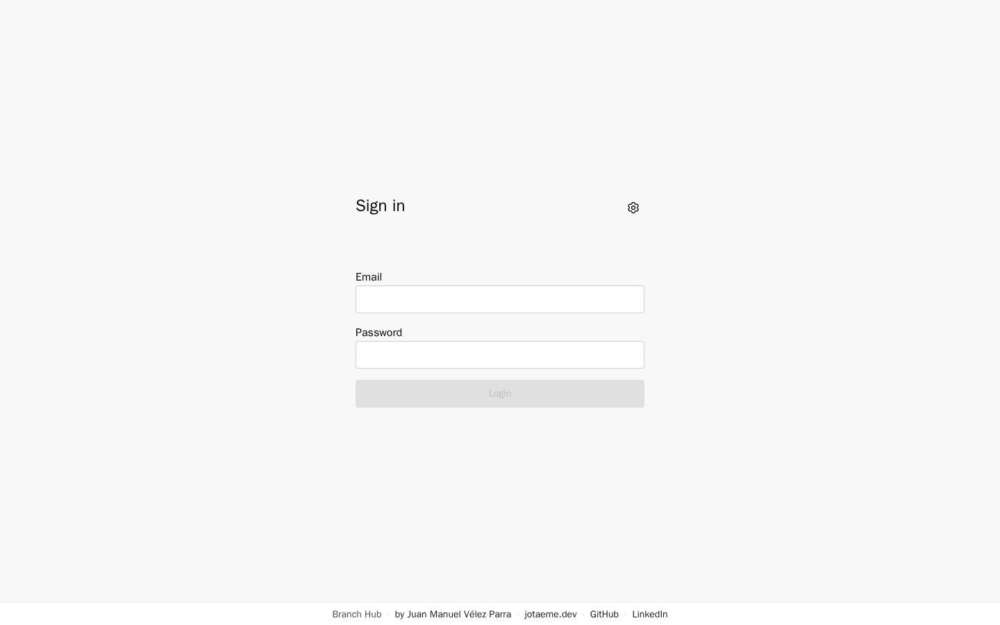
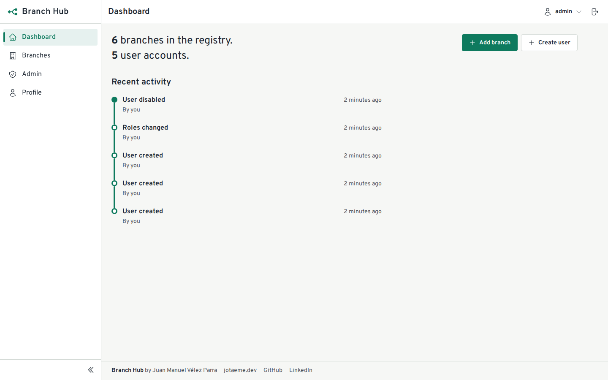
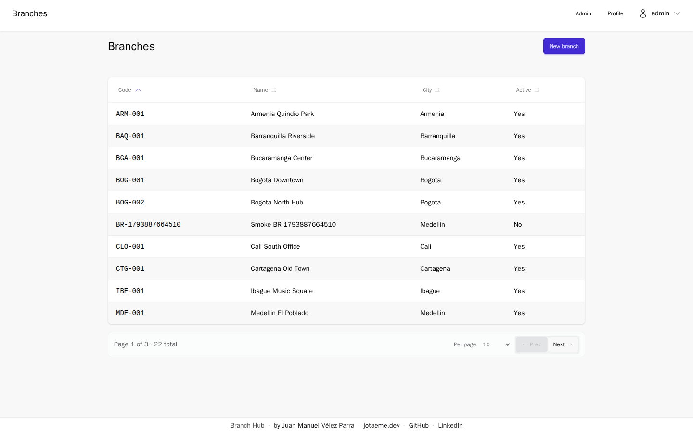
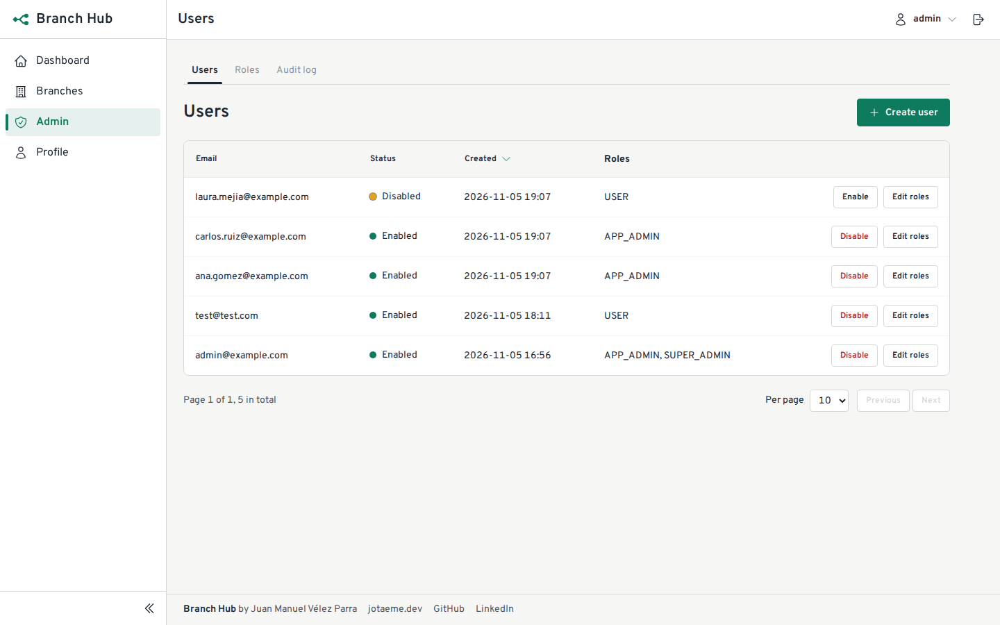
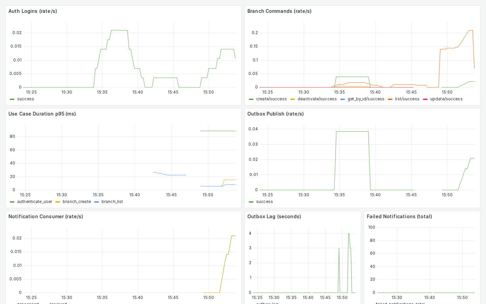
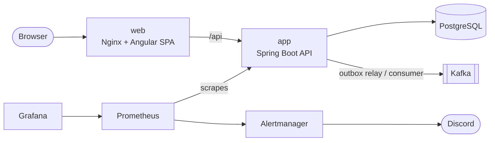

# Branch Hub

A full-stack app to manage company branches, built like a production system: Spring Boot 4 + Angular 21, secure by default, observable end to end.

## Live demo

- **App:** [code-branchhub.jotaeme.dev](https://code-branchhub.jotaeme.dev). Swagger UI is at [/swagger-ui.html](https://code-branchhub.jotaeme.dev/swagger-ui.html) on the same host.
- **Grafana (read-only, no login):** [code-branchhub-grafana.jotaeme.dev](https://code-branchhub-grafana.jotaeme.dev)

Both run on the prod overlay behind a Cloudflare Tunnel. Only the owner can log in to the app for now; a public demo account is planned.

## Highlights

- **Clean Architecture** in the API: `domain`, `application` (use cases and ports), `infrastructure` (adapters) and `entrypoints`, with no Spring Data or web types in the use cases.
- **Secure by default:** a short-lived JWT kept only in memory, an HttpOnly refresh cookie, role-based access (`SUPER_ADMIN`, `APP_ADMIN`), account lockout, an audit log, and a strict CSP on the SPA.
- **Reliable events:** branch writes use a transactional outbox. A relay publishes to Kafka, and the consumer is idempotent, with retries and a dead-letter topic.
- **Consistent API:** RFC 7807 Problem Details for every error, one pagination contract for all lists, and an OpenAPI spec.
- **Typed contract in the SPA:** TypeScript types are generated from the OpenAPI spec, so a renamed endpoint breaks the frontend build instead of production.
- **Observable end to end:** structured JSON logs with a transaction id, custom Micrometer metrics, a Grafana dashboard, and Prometheus alerts sent to Discord through Alertmanager.
- **Tested at every level:** unit and WebMvc tests, Testcontainers integration tests on PostgreSQL, Vitest for the SPA, and Playwright end-to-end smoke tests.

## Screenshots

| Login | Dashboard |
| ----- | --------- |
|  |  |

| Branches | Admin: users |
| -------- | ------------ |
|  |  |

| Grafana |
| ------- |
|  |

## Architecture



The SPA talks to the API through Nginx on the same origin. The API owns PostgreSQL and Kafka, and Prometheus, Grafana and Alertmanager watch it. More diagrams (backend layers, the outbox sequence) and the key flows are in [docs/architecture.md](docs/architecture.md).

## Tech stack

| Area | Technologies |
| ---- | ------------ |
| Backend | Java 25, Spring Boot 4, Spring Security, Spring Data JPA, springdoc-openapi, Gradle |
| Frontend | Angular 21 (standalone components, signals), TypeScript, TanStack Query, Tailwind CSS 4, DaisyUI 5 |
| Data and messaging | PostgreSQL 18, Flyway, Apache Kafka (transactional outbox) |
| Observability | Micrometer, Prometheus, Grafana, Alertmanager (Discord), Blackbox exporter, JSON logs |
| Testing | JUnit 6, Spring MVC slice tests, Testcontainers, Vitest, Playwright |
| Delivery | Docker, Docker Compose, Nginx |

## Quick start

```bash
cp .env.example .env    # set JWT_SECRET and APP_SUPER_ADMIN_PASSWORD
docker compose up -d --build
```

Then open the SPA at http://127.0.0.1:18090 (API: http://127.0.0.1:18091, Grafana: http://127.0.0.1:18092). Every host port is bound to `127.0.0.1` in the block 18090–18095. The full guide, including the Alertmanager files, the default login, running without Docker and the tests, is in [docs/getting-started.md](docs/getting-started.md).

## Project structure

```text
branch-hub/
├── backend/            # Spring Boot API (Gradle), Flyway scripts, tests
├── frontend/           # Angular SPA, Nginx config, Playwright e2e
├── monitoring/         # Prometheus, Alertmanager, Blackbox, Grafana
├── docs/               # Architecture, getting started, security, roadmap, Postman
├── docker-compose.yml  # Full local stack (project "branch-hub")
└── docker-compose.prod.yml  # Prod overlay: the published server stack
```

## Documentation

- [Getting started](docs/getting-started.md) and [architecture](docs/architecture.md)
- [Backend README](backend/README.md) and [frontend README](frontend/README.md)
- [Security notes](docs/security.md)
- [Documentation index](docs/README.md), including the Postman collection
- [Changelog](CHANGELOG.md)

## Roadmap

Releases `v1.0` to `v1.2` are done (API, SPA, hardening, identity and the admin platform); see [docs/roadmap/status.md](docs/roadmap/status.md) for what is next.

## Author

**Juan Manuel Vélez Parra** — Java Backend Engineer

- Website: [jotaeme.dev](https://jotaeme.dev)
- LinkedIn: [linkedin.com/in/juanmavelezpa](https://www.linkedin.com/in/juanmavelezpa)
- GitHub: [github.com/JuanMaVelezPa](https://github.com/JuanMaVelezPa)

## License

MIT. See [LICENSE](LICENSE).
