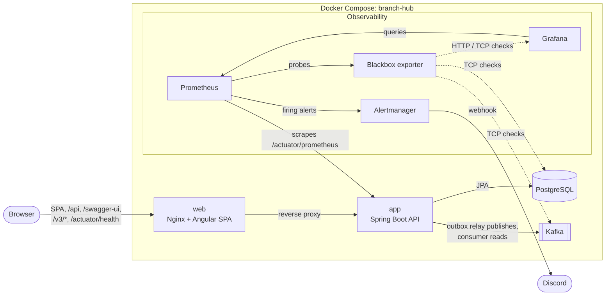
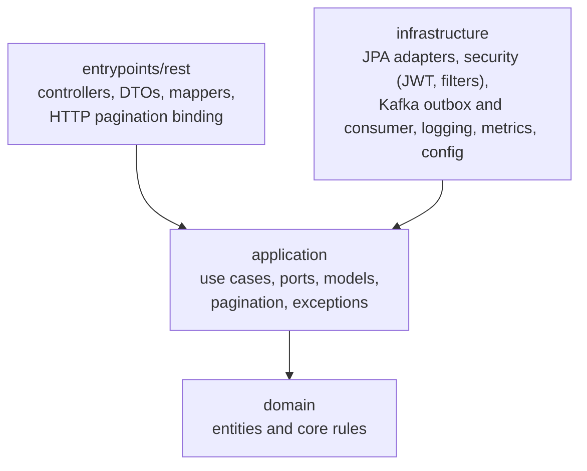
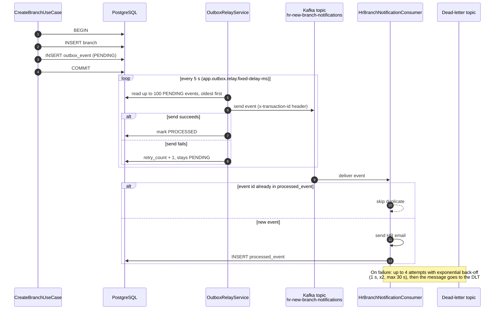

# Architecture

Branch Hub has three parts: a Spring Boot 4 API (`backend/`), an Angular 21 SPA (`frontend/`), and an observability stack (`monitoring/`). The HTTP contract under `/api/v1` is the boundary between the SPA and the API. Docker Compose runs everything on one network.

## System view

- **`web`** serves the SPA and proxies `/api`, `/swagger-ui`, `/v3/*` and `/actuator/health` to `app`, so the browser stays same-origin. Other `/actuator/*` paths return 404. Its CSP allows only `script-src 'self'`.
- **`app`** is the only service that talks to PostgreSQL and Kafka. It is also reachable directly on its own host port (`127.0.0.1:18091`) for tools such as Postman and Swagger UI. On the server only `web` and `grafana` join the `edge` network that `cloudflared` uses; see [getting-started.md](getting-started.md#server-mode-the-prod-overlay).
- **Prometheus** scrapes the API job `branch-hub-api` (`app:8080`) and uses the Blackbox exporter to probe Grafana, Kafka and PostgreSQL. The rules in group `branch-hub-alerts` go to Alertmanager, which posts to Discord.
- **Grafana** ships a provisioned dashboard, `branch-hub-observability`, built on the custom `app_*` metrics.

## Backend layers

The API follows Clean Architecture under `dev.jotaeme.branchhub`. Dependencies point inward: outer layers know about inner ones, never the other way round.

- **`domain`**: entities and their rules, for example `Branch`.
- **`application`**: use cases (`*/usecase`) and the ports they need (`*/port`). It holds framework-agnostic pagination (`common/pagination`) and exceptions, and has no Spring Data or web types.
- **`infrastructure`**: adapters that implement the ports. JPA lives under `persistence/` (IAM under `persistence/iam`); security, the Kafka notification flow, logging, metrics and configuration live here too.
- **`entrypoints/rest`**: controllers, request and response DTOs, mappers, and the HTTP side of pagination.

## Branch write: transactional outbox

Creating a branch must save the branch and announce it on Kafka without losing either. The use case writes both rows in one database transaction, and a separate relay publishes later.

- **Atomic write:** `branch` and `outbox_event` are saved together or not at all, so there is never a branch without an event, or an event without a branch.
- **At-least-once delivery:** the relay can publish the same event twice, for example if it crashes after sending and before marking the event `PROCESSED`.
- **Idempotent consumer:** the consumer records each event id in `processed_event` and skips ids it has already seen, so duplicates have no effect.
- **Retries and DLT:** `@RetryableTopic` retries a failing message and then sends it to the dead-letter topic. The DLT handler increments `failed_notifications_total` and `app_notification_consumer_total{outcome="dlt"}`, which feed the alerts.
- New domain events should follow the same pattern.

## Pagination

List endpoints share one pagination path, from the HTTP query to the JSON response:

1. `PageRequestParams` binds and validates `page`, `size` and `sort` from the query string.
2. `PaginationBinding` turns it into an application `PageQuery`, checked against a per-resource `SortPolicy` (for example `BranchListPagination.SORT_POLICY`).
3. The repository adapter returns a `PageSlice`. `SpringPageRequests` is the only place that builds a Spring `PageRequest`.
4. The use case returns a `PageResult`, and `PageMapper` turns it into `PagedResponse` (`content`, `totalElements`, `page`, `size`, `totalPages`).

Defaults: `page=0`, `size=10`, maximum `size=100`, `sort=property,asc|desc` with the allowed properties defined per resource.

## Errors

Handled errors are RFC 7807 Problem Details: `type`, `title`, `status`, `detail`, `instance`, `timestamp`, and an optional `errors` list for validation failures. `GlobalExceptionHandler` builds them for controller errors, and `SecurityConfig` builds the same shape for 401 and 403 responses. The `type` is `https://api.branch-hub/errors/{status}`.

## Authentication and access

- **Login** (`POST /api/v1/auth/login`) returns a short-lived access JWT in the response body and sets an HttpOnly refresh cookie. The SPA keeps the access token only in memory.
- **Refresh and logout** (`POST /api/v1/auth/refresh`, `POST /api/v1/auth/logout`) act on the refresh cookie.
- **In the SPA**, HTTP interceptors run in a fixed order: `apiInterceptor` → `authErrorInterceptor` → `refreshInterceptor`. On a 401, `refreshInterceptor` refreshes through the cookie and retries the request once.
- **Roles:**

  | Route | Access |
  | ----- | ------ |
  | `/api/v1/auth/**` | Public |
  | `GET /api/v1/me` | Any authenticated user |
  | `/api/v1/branches/**` | `SUPER_ADMIN` or `APP_ADMIN` |
  | `/api/v1/admin/**` (users, roles, audit log) | `SUPER_ADMIN` only, in the security config and with `@PreAuthorize` |

- **Bootstrap:** on startup the API creates the roles and a `SUPER_ADMIN` from `APP_SUPER_ADMIN_EMAIL` and `APP_SUPER_ADMIN_PASSWORD` if no account with that email exists.
- **Lockout:** repeated failed logins lock the account for a configurable time.

More detail: [security.md](security.md).

## Related docs

- [Getting started](getting-started.md)
- [Backend README](../backend/README.md)
- [Frontend README](../frontend/README.md)
- [Roadmap status](roadmap/status.md)
